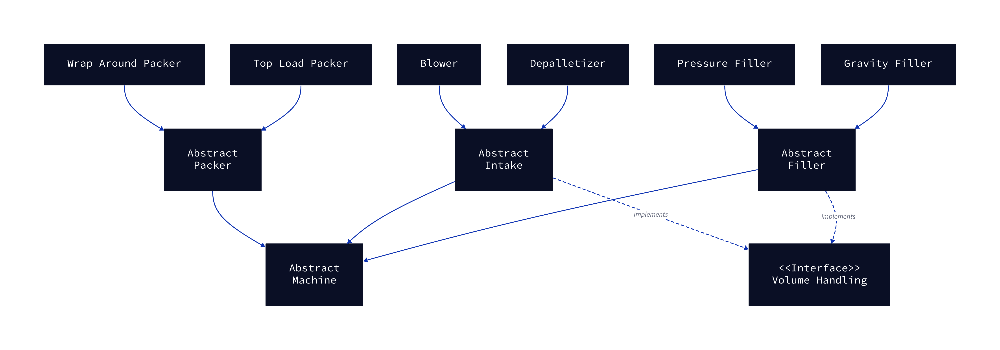

# Dr Pepper Bottle Plant

Project for the "Programmering med Java" course (DEV26M). A console
program that sizes a bottling plant: enter a desired output, an available
area and a budget, and it finds the cheapest machine setup that fits,
which can be saved as a shopping list (`list.txt`).



## Structure

All machines extend the abstract superclass `Machine`, which declares the
abstract methods `category()` and `describe()` that each subclass
overrides:

```
Machine
├── Intake (implements VolumeHandling) → Blower, Depalletizer
├── Filler (implements VolumeHandling) → GravityFiller, PressureFiller
└── Packer → TopLoadPacker, WrapAroundPacker
```

`VolumeHandling` is the project interface, shared by `Intake` and `Filler`.

| Package | Responsibility |
|---------|----------------|
| `Machine` | Domain model (the hierarchy above). |
| `Data` | `MachineLoader` reads `data/default.json` into `Machine` objects. |
| `Logic` | `Logic` holds the business rules; `Logic.CLI` handles the menu and user input. |

A line is one machine per stage (intake, filler, packer). Stages run in
sequence, so a line is only as fast as its slowest stage; more output is
reached by running several identical lines in parallel.

## Run

```
./gradlew run
```

Menu: Calculate, Browse, Search, Statistics; `q` to quit.

## Use of AI in this project
AI wrote a lot of code during the last day of the project. This is mainly due to poor planning on my part. 
Everything written before 16th of October is handwritten by me. 
In case of there being any questions, I am more than capable of answering them. 
Since this is a school subject; I am aware that the usage of AI is not recommended, but I still wanted to be 
transparent about it.

AI contributed the most to the `Logic` class and json parsing in `MachineLoader`. 
For parsing json I decided for [Jackson](https://javadoc.io/doc/tools.jackson.core/jackson-databind/latest/tools.jackson.databind/module-summary.html). I know little about this library so in any case I would have copied code from some source. 
In regard to `Logic` the only thing I would do differently if I wrote the code from scratch is to completely remove `String.format()`. 
It has unnecessary regex and is much less readable than simple `+` operators. Also, since `StringBuilder` is already there, `String.format()` really does not make sense.
